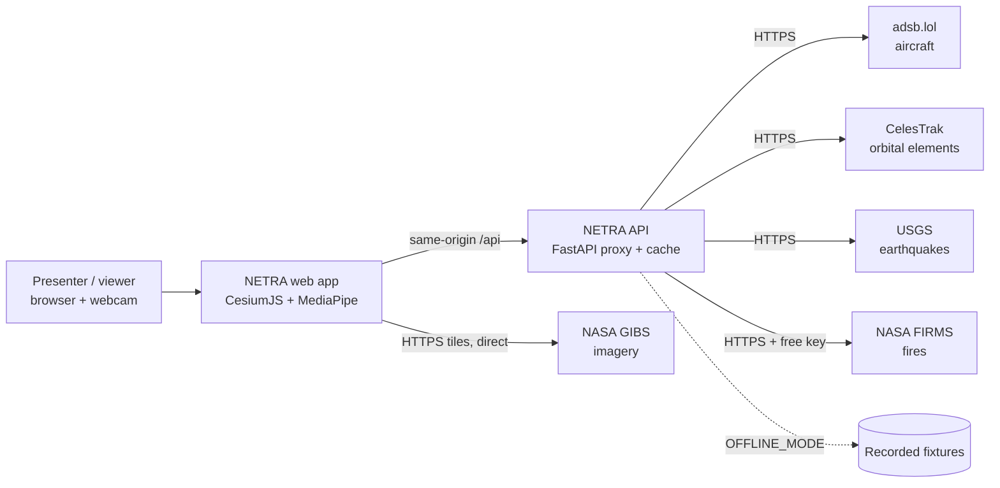
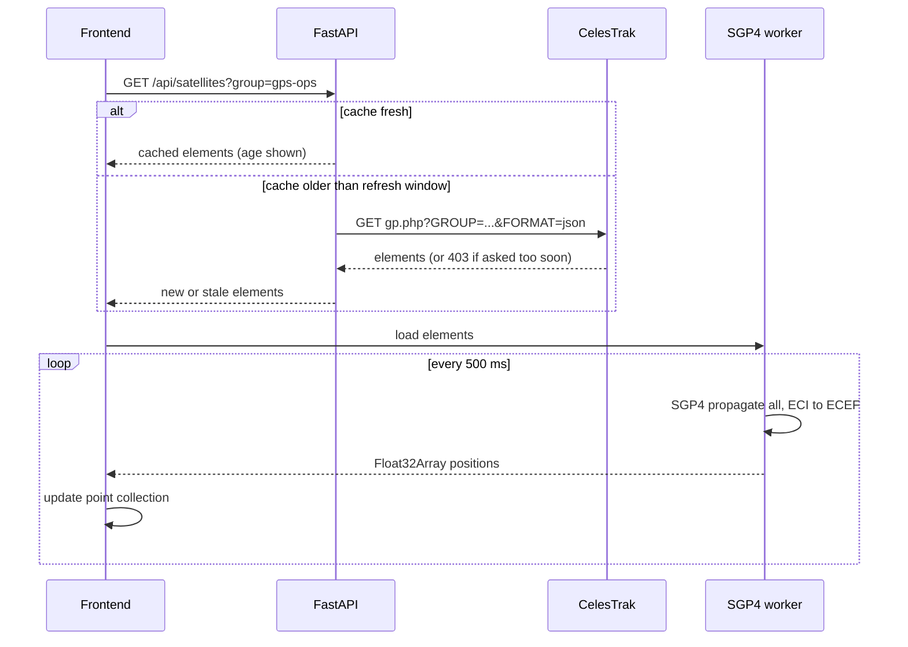
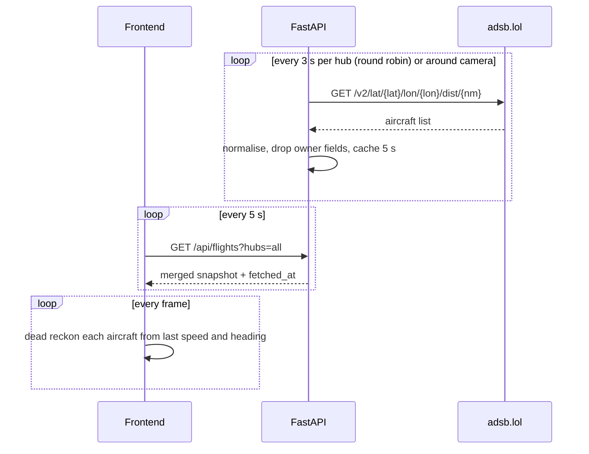

# NETRA: Architecture

Version 1.0 | 2026-10-31 | Skills applied: Architecture Designer (system design, trade-offs, ADRs), Microservices Architect (used to argue against splitting services), DevOps Engineer (deployment shape)

Principle: **the smallest architecture that makes the data pipeline real and the demo safe.** Two containers, one browser app. Nothing else.

---

## 1. System context



Plain-text version for places that do not render Mermaid:
```
 Browser (Cesium, MediaPipe, SGP4 worker)
        | same origin /api              \ direct tile requests
        v                                v
   Nginx (web) --proxy--> FastAPI (api)   NASA GIBS
                             |
        adsb.lol  CelesTrak  USGS  FIRMS   (or recorded fixtures when offline)
```

## 2. Containers and modules

| Unit | Responsibility | Does NOT do |
|---|---|---|
| `web` (Nginx) | Serves the built frontend, proxies `/api` to `api` | No business logic |
| `api` (FastAPI) | Fetch, validate, cache and normalise upstream data. Rate-limit upstream calls. Serve fixtures offline. Hold the only secret (FIRMS key). | No rendering, no gestures |
| Frontend: `core/` | App state, event bus, config, clock | |
| Frontend: `globe/` | Cesium viewer, layers, camera, imagery | |
| Frontend: `workers/sgp4.worker.js` | Propagate satellites off the main thread | No DOM |
| Frontend: `layers/` | `satellites`, `aircraft`, `quakes`, `fires`, `scan`, `zones` | |
| Frontend: `ui/` | HUD, dossier, feed, layer panel, boot, about | |
| Frontend: `input/` | `gestures/` (MediaPipe + classifier + state machine) and `mouse/` | Gestures never touch Cesium directly. They emit intents. |
| Frontend: `data/` | API client, polling scheduler, replay buffer | |

**Key seam:** input devices produce *intents* (`ROTATE(dx,dy)`, `ZOOM(dz)`, `FLY_TO(target)`, `NEXT_MODE`). Mouse and gestures emit the same intents, so mouse parity is free and gestures can be tested without a camera.

## 3. Runtime flows

### 3.1 Satellites

The network is touched once per refresh window. Motion is pure computation.

### 3.2 Aircraft


### 3.3 Gestures
```
webcam -> MediaPipe HandLandmarker (21 landmarks)
       -> feature extraction (palm size, pinch ratio, finger extension)
       -> smoothing filter
       -> gesture classifier (OPEN_PALM, PINCH, FIST, THUMBS_UP, NONE)
       -> state machine (IDLE, PAN, ZOOM, FLY_ARMED)
       -> intents -> camera controller -> Cesium camera
```

## 4. Data and caching

| Source | Method | Refresh used | Server cache | On failure |
|---|---|---|---|---|
| CelesTrak GP | `gp.php` JSON per group | Once per upstream refresh window (about 2 h) | Memory plus disk volume | Serve disk copy, mark STALE |
| adsb.lol | Radius query per hub | 3 s per hub, 5 s to the browser | Memory, 5 s TTL | Serve last snapshot, mark STALE after 60 s |
| USGS | GeoJSON feed | 60 s | Memory, 60 s | Serve last list |
| NASA FIRMS | Area CSV, free key | 10 min | Memory, 10 min | Hide layer if no key, serve last on error |
| NASA GIBS | WMTS tiles, from the browser | Browser cache | None (not proxied) | Natural Earth fallback |
| Fixtures | Recorded JSON | n/a | Disk | Used when `OFFLINE_MODE=true` |

**Why GIBS tiles are not proxied:** tile traffic is heavy, public and cacheable by the browser. Proxying adds latency and cost for no benefit.

## 5. Architecture Decision Records

### ADR-001 CesiumJS for the globe
- **Context:** need a true 3D globe with real geodesy, camera fly-to, imagery layers and terrain.
- **Options:** CesiumJS, deck.gl, Three.js with a custom globe, Mapbox/MapLibre globe.
- **Decision:** CesiumJS.
- **Why:** correct WGS84 geometry, GIBS imagery support, built-in camera flights and post-processing. Three.js would mean building the globe, picking and tiling by hand in 48 hours.
- **Consequences:** larger bundle. Entities do not scale, so use primitive collections (ADR-007).

### ADR-002 FastAPI caching proxy between browser and upstreams
- **Context:** CelesTrak limits repeat requests, adsb.lol is a community service, FIRMS needs a key, and browsers face CORS.
- **Decision:** a thin FastAPI service owns all upstream calls.
- **Why:** one place for rate limits, caching, stale-while-error, secrets and fixtures. It is also a real pipeline to defend in the viva.
- **Consequences:** one more container. Mitigated by Compose.

### ADR-003 SGP4 on the client, in a Web Worker
- **Decision:** the backend sends orbital elements. The browser propagates.
- **Why:** positions change every second. Sending positions would mean constant traffic. Elements change every few hours. A worker keeps the UI at 30+ FPS.
- **Trade-off:** library choice matters (satellite.js). Verify its OMM/JSON support at install time.

### ADR-004 adsb.lol instead of OpenSky
- **Decision:** adsb.lol as the aircraft source.
- **Why:** free, no key or account, community-run, ODbL-licensed data.
- **Trade-off:** coverage depends on volunteer receivers. Say so in the UI and viva. Re-check the API docs for a bulk endpoint first (Q1 in `prd.md`).

### ADR-005 REST polling, not WebSocket
- **Decision:** the browser polls every 5 s. No WebSocket or SSE in the must-have scope.
- **Why:** upstream data arrives in snapshots anyway. Dead reckoning hides the gaps. Polling is trivial to test and to replay from fixtures.
- **Revisit:** if replay needs pushed events. Not before Monday.

### ADR-006 Docker Compose, not Kubernetes
- **Decision:** two containers in Compose.
- **Why:** one laptop, one demo. Kubernetes adds failure modes and no benefit. If asked: the service boundary (stateless web, API with a volume) would map directly to a Deployment and a PersistentVolumeClaim.

### ADR-007 Primitive collections, not Entities
- **Decision:** `PointPrimitiveCollection` for satellites and fires, `BillboardCollection` for aircraft. Entities only for the selected object, quakes and zones.
- **Why:** entities cost far too much per object at thousands. Primitives batch into few draw calls.

### ADR-008 MediaPipe on the main thread, throttled
- **Decision:** run hand tracking from the video frame callback at about 30 Hz on the main thread, with the SGP4 work already in a worker.
- **Why:** simplest path with the fewest message hops. Revisit only if profiling shows jank.

### ADR-009 Offline fixtures as a first-class mode
- **Decision:** a recorder script and a `OFFLINE_MODE` flag, with an honest REPLAY banner.
- **Why:** venue Wi-Fi is the most likely failure. The demo must survive it without lying about being live.

### ADR-010 No database
- **Decision:** memory and disk files only.
- **Why:** no persistent domain data. Revisit if the department requires a database (R7): add SQLite for the alert log and replay buffer.

## 6. Failure modes

| Failure | Detection | System behaviour | User sees |
|---|---|---|---|
| adsb.lol down or slow | Timeout, non-200 | Serve last snapshot | ADSB badge amber after 60 s, banner |
| CelesTrak 403 (asked too soon) | Status 403 | Serve disk cache | CT badge shows age |
| USGS down | Timeout | Serve last list | USGS badge amber |
| No FIRMS key | Env check at start | Disable the layer | Toggle hidden, boot line "--" |
| GIBS tiles fail | Imagery error event | Switch to Natural Earth | Notice |
| API down entirely | Fetch error | Frontend keeps showing last data, retries with backoff | Red banner, Retry |
| No webcam or permission denied | `getUserMedia` error | Mouse mode | Message from `wireframe.md` W5 |
| GPU too slow | FPS monitor under 20 for 5 s | Reduce satellite and aircraft caps by 30%, disable post-process | "Performance mode" chip |
| Offline venue | Network error plus flag | Fixtures | REPLAY banner with recording time |

## 7. Performance budget

| Item | Budget |
|---|---|
| Frame time at target load | 33 ms (30 FPS) |
| SGP4 batch for 2,500 objects | under 8 ms in the worker, run every 500 ms |
| Aircraft update per frame | under 3 ms for 1,800 aircraft (typed arrays, no allocation in the loop) |
| Gesture pipeline | 30 Hz, end-to-end latency under 100 ms |
| Dossier open after click | under 200 ms |
| API response (cached) | under 50 ms |
| Frontend bundle (gzip) | under 3 MB excluding Cesium assets |

## 8. Security boundary
- The browser talks only to its own origin (`/api`) and to NASA GIBS tiles.
- The API talks only to a fixed allowlist of upstream hosts. No URL comes from the client. This removes server-side request forgery risk.
- The only secret is `FIRMS_MAP_KEY`, read from the environment, never sent to the browser, never logged.
- Client inputs (`lat`, `lon`, `dist`, `group`) are validated against ranges and allowlists.
- Aircraft owner and registration fields are dropped at the API by default.
- Details and checklist: `software_engineering.md` section 7.

## 9. Deployment

```
docker-compose.yml
  web:  nginx (serves /usr/share/nginx/html built by Vite, proxies /api -> api:8000), port 8080
  api:  python 3.12 slim, uvicorn, volume ./data/cache:/app/cache, env_file .env
```
- Dev: `npm run dev` (Vite, proxy `/api` to `localhost:8000`) and `uvicorn app.main:app --reload`.
- Demo: `docker compose up --build`, open `http://localhost:8080`.
- Offline: `OFFLINE_MODE=true docker compose up`.
- Health: `GET /api/health`, container healthchecks on both services.

## 10. What we deliberately did not build
Message queue, database, auth, WebSocket server, microservices, Kubernetes, CDN, tile proxy. Each would cost hours and add nothing the panel can see.

## 11. Evolution path (after Monday)
SQLite alert history, WebSocket push, more feeds (ships, weather radar), a plugin interface for layers, a hosted demo with a read-only data mode.